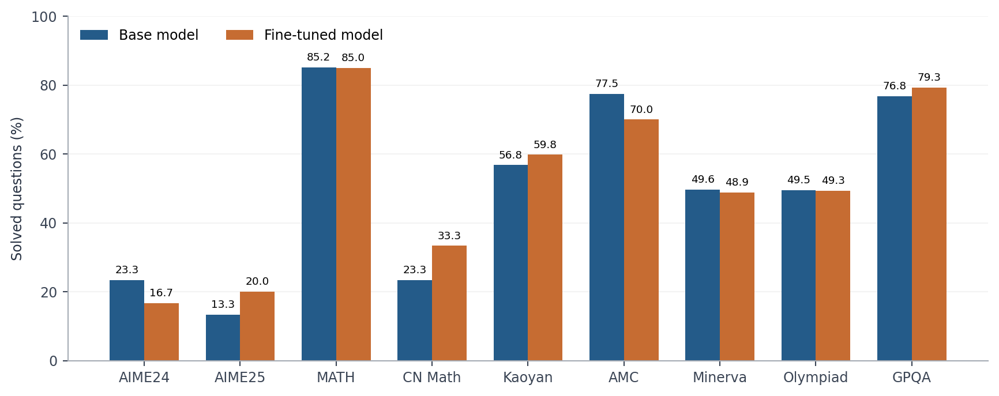
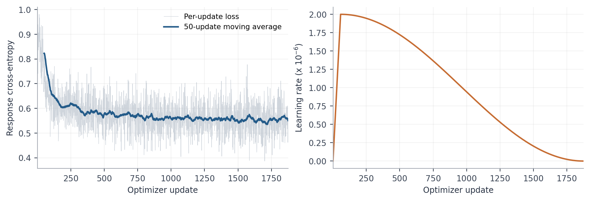

# Qwen2.5-3B Reasoning SFT

Supervised fine-tuning of **Qwen2.5-3B-Instruct** on 15,000 AceReason examples, with baseline evaluation, advanced data selection and benchmark analysis.

[Report (PDF)](REPORT.pdf) · [LaTeX source](report/report.tex) · [Hugging Face model](https://huggingface.co/rohitspider/reasoning-sft-submission-full-15k) · [Training datasets](https://huggingface.co/datasets/rohitspider/reasoning-sft-submission-data-15k)

## Overview

This project studies how training-data selection affects mathematical and scientific reasoning. We evaluate the original model, select a diverse training subset, perform full-parameter SFT with LLaMA-Factory, and compare the resulting model using the same evaluation settings.

## Data Selection

Both datasets contain 15,000 examples from the prepared AceReason pool:

- **Random:** fixed-seed random sampling.
- **Advanced:** quality and answer-completeness filtering, repetition filtering, and reasoning-route diversity using lexical features, clustering and square-root quotas.

The submitted model uses the advanced dataset. A matched full-model random-data evaluation was not completed. Dataset preparation uses an 8,192-token selection cutoff; the completed training run uses a 4,096-token context.

## Training Configuration

| Parameter | Value |
|---|---|
| Base model | Qwen2.5-3B-Instruct |
| Method | Full-parameter supervised fine-tuning |
| Training examples | 15,000 |
| Context length | 4,096 tokens |
| Optimizer updates | 1,875 |
| Learning rate | 2e-6 |
| Effective batch size | 8 |
| Schedule | Cosine, 3% warmup |
| Precision | BF16 mixed precision |
| Seed | 42 |

The training configuration is in [configs/train.yaml](configs/train.yaml).

## Evaluation

Base and fine-tuned models were evaluated on the same 1,974 questions, with eight generated answers per question. A question counts as solved for pass@8 if any answer is correct.

| Setting | Value |
|---|---|
| Temperature | 0.6 |
| Top-p | 0.95 |
| Samples per question | 8 |
| Maximum new tokens | 32,768 |
| Evaluation GPU | One NVIDIA B200 |

## Benchmark Results

| Benchmark | Base pass@8 | Fine-tuned pass@8 |
|---|---:|---:|
| AIME 2024 | 23.33% | 16.67% |
| AIME 2025 | 13.33% | 20.00% |
| MATH-500 | 85.20% | 85.00% |
| CN Math 2024 | 23.33% | 33.33% |
| Kaoyan | 56.78% | 59.80% |
| AMC | 77.50% | 70.00% |
| Minerva Math | 49.63% | 48.90% |
| OlympiadBench | 49.48% | 49.33% |
| GPQA-Diamond | 76.77% | 79.29% |

The assignment's seven-benchmark average pass@8 increases from **49.55% to 51.52%**, a **1.97 percentage-point** gain. This average covers AIME 2025, CN Math 2024, Kaoyan, AMC, Minerva Math, OlympiadBench and GPQA.

Results are mixed across individual benchmarks. The paired 95% interval for the average improvement is −1.89 to +5.74 percentage points, so the observed gain is not statistically conclusive. Average pass@1 decreases from 23.55% to 21.85%, and truncated responses increase from 141 to 1,964 out of 15,792 samples. See the [report](REPORT.md) for analysis and limitations.

## Plots





## Getting Started

Download the public model and datasets:

```bash
pip install huggingface_hub
python scripts/download_artifacts.py
```

Use the Qwen chat template when loading the model with Transformers. Training and evaluation setup is documented in [REPRODUCE.md](REPRODUCE.md).

## Repository Contents

| Path | Contents |
|---|---|
| [REPORT.pdf](REPORT.pdf) | Detailed academic report with figures and references |
| [report/](report/) | LaTeX source and plot-generation code |
| [REPORT.md](REPORT.md) | Report summary |
| [RESULTS.md](RESULTS.md) | Detailed benchmark results |
| [configs/](configs/) | Training configuration |
| [reasoning/](reasoning/) | Data selection and evaluation code |
| [eval/](eval/) | Benchmark evaluation and grading |
| [results/](results/) | Baseline and fine-tuned evaluation records |
| [LLaMA-Factory/](LLaMA-Factory/) | Training implementation |

## Resources

- [Assignment](https://github.com/reds-lab/Project-Reasoning-SFT-LLM)
- [Qwen2.5-3B-Instruct](https://huggingface.co/Qwen/Qwen2.5-3B-Instruct)
- [AceReason-100K](https://huggingface.co/datasets/redsgnaoh/acereason11_100k)
- [LLaMA-Factory](https://github.com/hiyouga/LLaMA-Factory)

Upstream model, dataset and software licenses apply.
