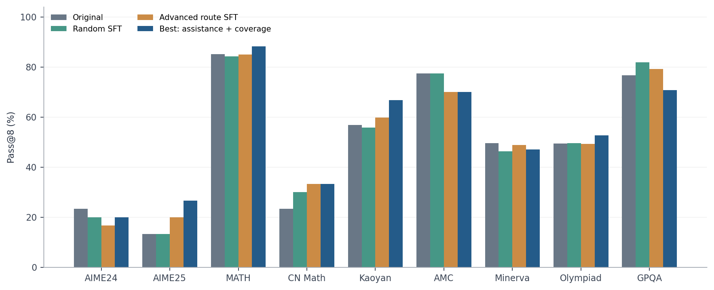

# Project 1: SFT LLM for Enhancing Reasoning

**Rohit Kumar Salla · Manoj Saravanan · Haissam Adam**

**Current best fully measured result: 3/9 fixed targets met** (AIME 2025, Minerva Math and GPQA-Diamond), using one assistance-and-coverage model. Its seven-benchmark average pass@8 is **52.4773%**, compared with **50.6262% random SFT**, **51.5222% advanced route SFT**, and **49.5474% original Qwen2.5-3B-Instruct**. Nine-target success and an official leaderboard rank are not claimed.

[Grading evidence](RUBRIC.md) · [Report PDF](REPORT.pdf) · [Report summary](REPORT.md) · [All nine results](RESULTS.md) · [Reproduction](REPRODUCE.md) · [Submission checklist](SUBMISSION_CHECKLIST.md)

## Results at a glance

| Completed model | Seven-task pass@1 | Seven-task pass@8 | Truncated / 15,792 |
|---|---:|---:|---:|
| Original model | 23.5497% | 49.5474% | 141 |
| Random SFT | 21.1928% | 50.6262% | 2,494 |
| Advanced route SFT (published) | 21.8526% | 51.5222% | 1,964 |
| Assistance + coverage (best measured) | 22.9398% | 52.4773% | 2,324 |

Each model completed the same nine-benchmark suite: 1,974 questions × eight responses, with matching B200 hardware, evaluator, questions, seeds and decoding settings. The seven-task mean follows the assignment's aggregation rule. See [RESULTS.md](RESULTS.md) for per-benchmark scores, target thresholds and limitations.



## Grading navigation

| Rubric category | Points available | Evidence |
|---|---:|---|
| Environment and reproducibility | 10 | [Installation, commands and seeds](REPRODUCE.md), [dependencies](requirements-train-observed.txt), [configs](configs/) |
| Dataset preparation | 15 | [Preparation and selection](DATA_SELECTION.md), [both public 15K datasets](https://huggingface.co/datasets/rohitspider/reasoning-sft-submission-data-15k/tree/course-submission-20261020-authors) |
| SFT implementation and training | 20 | [LLaMA-Factory](LLaMA-Factory/), [random config](configs/train_random.yaml), [advanced config](configs/train.yaml), [training evidence](results/rubric-comparison/), [published advanced model](https://huggingface.co/rohitspider/reasoning-sft-submission-full-15k/tree/course-submission-20261020-authors) |
| Model evaluation | 20 | [Original, random, advanced and best results](RESULTS.md), [shared protocol](results/rubric-comparison/protocol.json), [CPU result verifier](scripts/verify_submission.py) |
| Advanced data selection | 20 | [Motivation, algorithm and comparison](DATA_SELECTION.md), [route implementation](reasoning/routes.py), [assistance selector](reasoning/assistance_selection.py) |
| Report and analysis | 15 | [PDF](REPORT.pdf), [LaTeX](report/report.tex), [findings and limits](REPORT.md), [figures](report/figures/) |

Points above reproduce the instructor's category weights; they are not self-awarded scores. [RUBRIC.md](RUBRIC.md) maps every subcriterion and names remaining artifact gaps.

## Public artifacts and model identity

- [Random and advanced datasets](https://huggingface.co/datasets/rohitspider/reasoning-sft-submission-data-15k): `random.json` and `advanced.json`, 15,000 original AceReason examples each.
- [Published full-parameter advanced model](https://huggingface.co/rohitspider/reasoning-sft-submission-full-15k): the **51.5222%** advanced route model, trained for one epoch at 4K context.
- **Best measured model:** assistance + coverage, **52.4773%, 3/9**, three epochs at 16K context. Its score records, training history, portable configuration and selector are included here. Its weights and distinct training export are **not yet published**. The download command below retrieves the published advanced model.

The best-versus-random comparison changes context, learning rate and number of epochs in addition to selection. The one-epoch random-versus-advanced comparison holds those training settings fixed. Current exploratory runs are excluded from all reported scores.

## Quick start

```bash
python3 -m venv .venv-download
source .venv-download/bin/activate
pip install huggingface_hub
python scripts/download_artifacts.py
python3 scripts/verify_submission.py
```

For separate training and evaluation environments, exact commands, source preparation and artifact limitations, see [REPRODUCE.md](REPRODUCE.md). Verification uses the standard library and does not require a GPU. Model training and generation require suitable CUDA hardware.

## Limitations and next work

The best result still misses six fixed targets. Average single-sample correctness declines relative to the original, and truncation rises substantially. Scores come from exploratory development and a single training seed, so neither selection-only causality nor statistically conclusive superiority is established. The report discusses these tradeoffs and the effect of GPU availability. Future runs must complete and be measured before replacing this snapshot.

## Resources

[Assignment](https://github.com/reds-lab/Project-Reasoning-SFT-LLM) · [Qwen2.5-3B-Instruct](https://huggingface.co/Qwen/Qwen2.5-3B-Instruct) · [AceReason source](https://huggingface.co/datasets/redsgnaoh/acereason11_100k) · [LLaMA-Factory](https://github.com/hiyouga/LLaMA-Factory)

Upstream model, dataset and software licenses apply. This repository does not claim a top-five LiveBenchmark placement or the leaderboard bonus.
